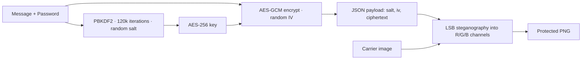

<div align="center">

# 🔒 SafeData

**Hide a private message inside an ordinary image. Lock it with a password. Share it like any other photo.**

[](https://react.dev)
[](https://vitejs.dev)
[](https://developer.mozilla.org/en-US/docs/Web/API/Web_Crypto_API)
[](#-privacy-model)

</div>

<!-- Add a screenshot: save it as docs/screenshot.png and uncomment the next line

-->

SafeData combines **encryption** and **steganography** in a single in-browser tool. Your message is encrypted with a password, then tucked into the pixels of an image you choose. To everyone else it is just a photo. To the person with the password, it is a message waiting to be unlocked.

Everything runs locally. There is no server, no upload, and no account.

##  Features

- **Encode:** pick an image, set a password, write a message, then download a protected PNG.
- **Decode:** drop in a protected image, enter the password, and read the message.
- **Private by design:** images and passwords never leave your device.
- **Strong encryption:** AES-256-GCM with a PBKDF2-SHA256 derived key, via the browser's native Web Crypto API.
- **Tamper and wrong-password detection:** GCM authentication means you get the message or a clear failure, never garbage.
- **Drag and drop**, live character count, image capacity checks, and side-by-side original and protected previews.
- **Responsive** marketing site and Studio, with `prefers-reduced-motion` respected.

##  How it works



1. **Key derivation:** the password is stretched into a 256-bit key with PBKDF2 and a fresh 16-byte salt.
2. **Encryption:** the message is encrypted with AES-GCM using a fresh 12-byte IV. GCM also adds an authentication tag.
3. **Packaging:** salt, IV, and ciphertext go into a small JSON envelope tagged `SAFEDATA_STEGO_V1`.
4. **Hiding:** a 32-bit length header and the payload bits replace the least-significant bit of each red, green, and blue value. The change is invisible to the eye. Capacity is roughly 3 bits per pixel.
5. **Output:** the result is saved as a lossless PNG so the hidden bits survive.

Decoding reverses the process. A wrong password fails the GCM authentication check, so the app reports that the password could not unlock the message.

##  Getting started

```bash
git clone https://github.com/<your-username>/safedata.git
cd safedata
npm install
npm run dev
```

Then open <http://localhost:5173>.

| Command | What it does |
| --- | --- |
| `npm run dev` | Start the dev server with hot reload |
| `npm run build` | Create a production build in `dist/` |
| `npm run preview` | Serve the production build locally |

##  Project structure

```
src/
├── main.jsx              Entry point (BrowserRouter)
├── App.jsx               Routes: /  and  /studio
├── styles.css            Global design system and page styles
├── pages/
│   ├── Home.jsx          Landing page
│   └── Studio.jsx        Encode / decode tabs
├── components/
│   ├── Header.jsx        Home and Studio headers
│   ├── Footer.jsx        Footer with subscribe form
│   ├── FileDrop.jsx      Drag-and-drop image picker
│   ├── EncodePanel.jsx   Encrypt and hide flow
│   └── DecodePanel.jsx   Extract and decrypt flow
├── hooks/
│   ├── useReveal.js      Scroll-in animations
│   └── useDocumentMeta.js  Per-page title and description
└── lib/
    ├── crypto.js         PBKDF2 + AES-GCM (Web Crypto)
    └── stego.js          LSB embed and extract on canvas pixels
```

##  Privacy model

- No network requests are made with your images, passwords, or messages. Everything happens in the browser.
- Passwords are not stored anywhere. If you lose one, the message cannot be recovered.
- The only external request is Google Fonts for typography.

## ⚠️ Limitations

Please read these before relying on SafeData for anything sensitive.

- **Do not send the image as a normal photo on apps that recompress images.** WhatsApp, Instagram, and similar services re-encode photos, which changes pixel values and destroys the hidden data. Send the protected PNG as a **file or document** instead.
- **Steganography is not invisibility against experts.** The encryption is strong, but statistical steganalysis can sometimes detect that an image *contains* hidden data. Without the password it still cannot be read.
- **Security depends on the password.** Use a long, unique passphrase.
- **Capacity is limited by image size.** The app warns you if the message does not fit.
- This is an educational and personal-use project and has not had an independent security audit.

##  Deployment

The app uses client-side routing, so the host must serve `index.html` for unknown paths such as `/studio`. Config for the common hosts is included:

- **Netlify:** `public/_redirects`
- **Vercel:** `vercel.json`
- **Other hosts:** add a "single-page app" fallback to `index.html`.

##  Roadmap ideas

- [ ] Raise PBKDF2 iterations (OWASP currently recommends far more than 120,000 for SHA-256)
- [ ] Password strength meter
- [ ] Hide files, not just text
- [ ] Warn when a recompressed or lossy image is chosen for decoding
- [ ] Unit tests for the crypto and steganography modules

##  Contributing

Issues and pull requests are welcome. For larger changes, please open an issue first to discuss what you would like to change.

---

<div align="center"><sub>Made quietly, kept safely.</sub></div>
